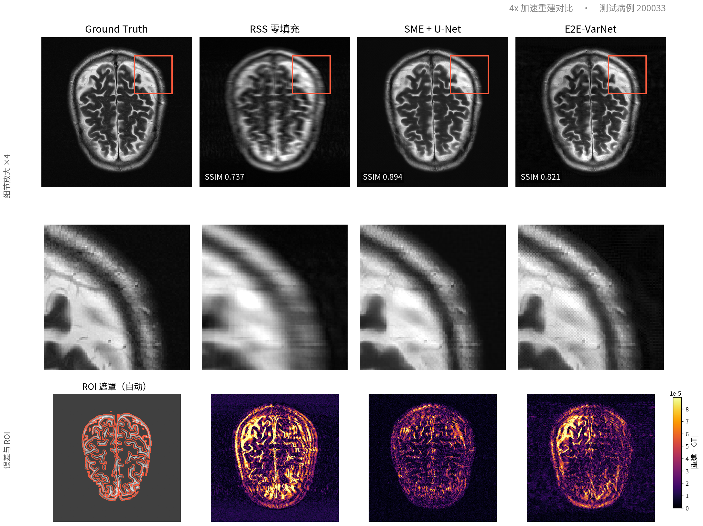
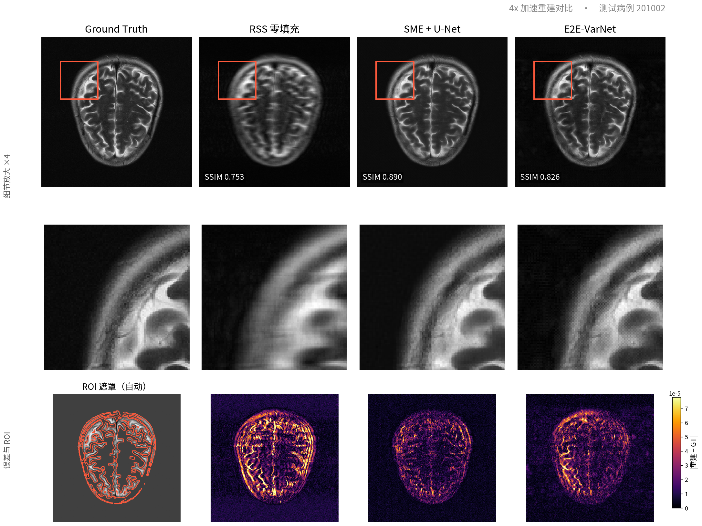
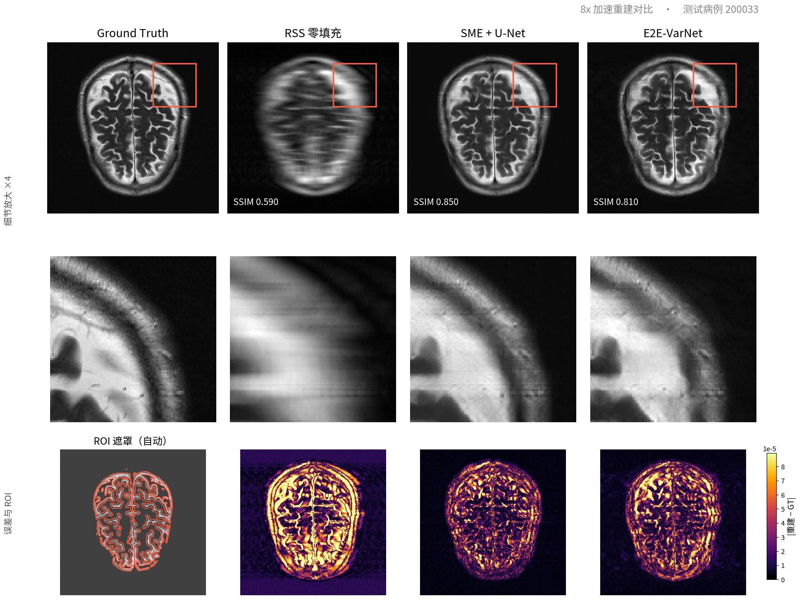
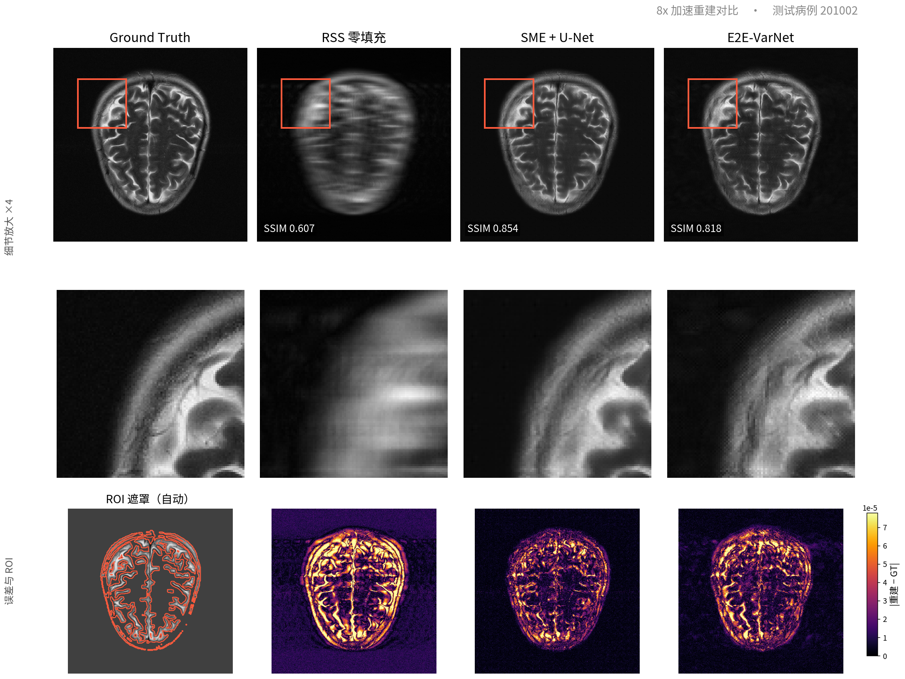

# Brain Multicoil MRI 加速重建：从并行成像到深度学习的技术演进

基于 fastMRI brain multicoil 数据集，探索欠采样 MRI 加速重建的深度学习方法，完整覆盖从经典并行成像基线（RSS）、灵敏度感知的单次重建（SME+U-Net），到多级联端到端变分网络（E2E-VarNet）的技术演进路径。项目同时包含一套严格的四维度评估体系（全图 / 背景遮罩 / ROI遮罩 / LPIPS感知距离）与针对性的训练目标设计，用于系统性验证"评估指标是否真实反映重建质量"这一核心问题。

## 项目背景

MRI 扫描耗时较长，通过欠采样 k-space 数据可以显著加速扫描过程，但会导致重建图像出现混叠伪影。本项目在真实的多线圈脑部 MRI 数据上，比较了不同复杂度的深度学习重建方法在 4x 与 8x 加速倍数下的表现，并系统性地探讨了"模型架构复杂度"与"训练资源（数据量、训练时长）"之间的实际权衡——这是本项目最核心的发现之一。

## 技术路线

```
RSS baseline (Root Sum of Squares，经典并行成像合并方法，不使用深度学习)
        │
        ▼
SME + U-Net (灵敏度图估计 + 单次图像域精修)
        │
        ▼
E2E-VarNet (灵敏度图估计 + 多级联迭代式数据一致性重建)
```

### RSS baseline

对每个线圈独立做 IFFT 得到复数图像，再逐像素做平方和开根号合并。这是并行成像领域最基础、不涉及任何训练的合并方法，作为衡量深度学习方法真实增益的参照基准。RSS 本质上没有显式利用多线圈的空间灵敏度差异信息，只是做了简单的能量平均。

### SME + U-Net

- **SME (Sensitivity Map Estimation)**：从欠采样 k-space 的 ACS（自动校准）区域，用小型卷积网络估计每个线圈的空间灵敏度图，是对经典并行成像算法（如 SENSE）中"预先标定线圈灵敏度"这一步骤的深度学习替代。
- 用估计出的灵敏度图，对多线圈图像做 SENSE 风格的加权合并（保留相位信息，比 RSS 更精确地利用线圈空间信息）。
- 合并后的图像经过 U-Net 在图像域做一次精修，得到最终重建结果。

### E2E-VarNet

在 SME+U-Net 的基础上，把"合并 → 精修"这一单次过程，升级为多个级联的"合并 → 精修 → 展开回多线圈 k-space → 数据一致性纠正"的迭代循环（本项目使用 4 个级联）。每一轮迭代都会用真实测量数据，强制修正已采样位置的k-space 值，理论上应该比单次处理更能保证物理一致性。

## 数据

- **数据集**：fastMRI brain multicoil，AXT2 序列
- **线圈压缩**：原始数据线圈数量不统一（4/6/8/10/12/14/16/18/20 均有出现），使用基于 SVD 的线圈压缩技术，将所有线圈数 ≥ 8 的文件统一压缩为 8 个虚拟线圈，在几乎不损失信号信息的前提下（模拟实验中压缩前后 RSS 图像相关系数达 0.999+），将可用数据量从 90 个文件（严格要求原始 20 线圈）扩大至 164个文件，训练数据量提升约 82%。
- **Ground Truth 尺寸筛选**：不同文件的 GT 尺寸存在 320×320 与 384×384 两种规格，可能反映不同扫描协议的实际视野差异而非单纯的数据缺失，因此采用筛选而非强行统一（补零/缩放）的策略，统一使用数量占多数的 384×384 规格（164 个文件中 384×384 占多数）。
- **数据划分**：训练集约 130 个文件，验证集与测试集各约 17 个文件（270 张切片），固定随机种子保证可复现。

## 评估方法论：为什么不能只看 SSIM

项目开发过程中发现一个关键问题：某个模型在全图 SSIM 上达到 0.85，但视觉上仍能观察到明显的细节模糊。深入分析后确认，这不是个例，而是 SSIM 这一指标本身的已知局限：

1. **均匀池化问题**：SSIM 是逐局部窗口比较后取平均，大面积、结构简单的背景/整体轮廓区域会稀释真正需要关注的细节区域（如脑沟脑回）的评分权重。
2. **对模糊不敏感**：SSIM 主要捕捉结构相关性，对"锐利度"这类感知层面的差异相对不敏感，这与图像质量评估文献中报告的 SSIM 局限性一致。

为此，本项目设计了四层递进的评估体系：

| 层级 | 说明 |
|---|---|
| 全图评估 | 不加任何遮罩，官方 fastMRI 挑战赛的标准评估口径 |
| 背景遮罩 | 噪底锚定自适应阈值（v3：max(2×四角噪底估计, 2%×最大值)）+ 形态学清理 + 最大连通域，排除颅骨外背景 |
| ROI 遮罩 | 在背景遮罩基础上，进一步用局部方差自动筛选出纹理丰富的细节区域（脑沟脑回），排除相对均匀的白质/脑脊液区域，最贴近临床关注点 |
| LPIPS | 基于预训练神经网络提取的深层特征计算感知距离，对模糊等失真比 SSIM 更敏感 |

评估工具本身的开发经历了三轮由真实失败驱动的迭代：v1 固定 5% 阈值在多线圈 RSS 噪声底（非中心卡方分布，实测达最大值的 3~4%）下背景大面积漏入前景（44/270 切片覆盖超 60%）；v2 改用 Otsu 自适应阈值修好了漏入，却在暗组织切片上把阈值推入组织区间（实测达 25% 最大值，暗组织与背景噪声在直方图上同属低亮度类），52% 切片错杀真实脑组织；现行 v3 改为噪底锚定阈值 max(2×四角噪底估计, 2%×最大值) + 形态学清理 + 最大连通域，经 270 切片全量可视化审计验收（泄漏 0、找回被错杀组织 96.3%），并防御了纯噪声退化切片的空遮罩边界情况（曾使 nan 污染全部均值）。另修复 SSIM 在 AMP 混合精度下的数值稳定性风险（强制 float32）。全量重评估确认：更换遮罩口径使背景/ROI 指标整体移动约 0.5~0.7dB，但所有方法共用同一遮罩，方法间排名与全部定性结论保持稳健。

## 训练目标：从"评估什么"到"优化什么"

如果只是在评估阶段引入 LPIPS 和 ROI 遮罩，而训练目标（loss）不做相应调整，模型不会真正在这些维度上变强，只会暴露出更真实（但未被针对性优化过）的弱点。因此本项目将完整的评估维度，同步设计进了训练目标：

```
Loss = α₁·L1(全图) + α₂·(1-SSIM)(全图) + α₃·LPIPS(全图) + α₄·L1(ROI加权)
```

- **L1 + SSIM**：基础的像素级与结构级重建损失。
- **LPIPS**：基于预训练网络的感知损失，直接针对"细节纹理是否真实"进行优化，弥补 L1/SSIM 对模糊不敏感的问题。LPIPS 骨干网络的所有参数被冻结，不参与训练更新，只提供感知层面的梯度指导。
- **ROI 加权 L1**：用 GT 图像的局部方差（PyTorch 实现，训练时逐 batch 实时计算），自动识别细节丰富区域，对这部分区域的重建误差施加额外权重（验证显示 ROI 区域内的梯度幅值约为区域外的 4 倍），让模型明确地被要求优先保证细节区域的精度。

## 实验结果

### 4x 加速

| 评估口径 | 方法 | PSNR (dB) | SSIM |
|---|---|---|---|
| 全图 | RSS baseline | 26.33 | 0.7225 |
| 全图 | SME+U-Net | 32.03 | 0.8901 |
| 全图 | E2E-VarNet | 30.06 | 0.8031 |
| 背景遮罩 | RSS baseline | 22.71 | 0.7073 |
| 背景遮罩 | SME+U-Net | 27.57 | 0.8401 |
| 背景遮罩 | E2E-VarNet | 26.41 | 0.8209 |
| **ROI遮罩** | RSS baseline | 20.72 | 0.6939 |
| **ROI遮罩** | SME+U-Net | 26.04 | **0.8827** |
| **ROI遮罩** | E2E-VarNet | 25.12 | 0.8808 |

LPIPS（越小越好）：RSS 0.2180 → SME+U-Net **0.0530** → E2E-VarNet 0.0807



*第一行：Ground Truth / RSS 零填充 / SME+U-Net / E2E-VarNet（橙色框为放大区域，角标为全图 SSIM）；第二行：橙框区域 ×4 放大，可直观比较脑沟脑回的锐利程度；第三行：ROI 遮罩（自动生成，独立展示，不叠加在 GT 上）与误差图 |重建−GT|（颜色越亮误差越大，三幅共用色标）。*



### 8x 加速

| 评估口径 | 方法 | PSNR (dB) | SSIM |
|---|---|---|---|
| 全图 | RSS baseline | 23.22 | 0.5981 |
| 全图 | SME+U-Net | 28.88 | 0.8546 |
| 全图 | E2E-VarNet | 27.91 | 0.8235 |
| 背景遮罩 | RSS baseline | 19.46 | 0.5337 |
| 背景遮罩 | SME+U-Net | 24.17 | 0.7390 |
| 背景遮罩 | E2E-VarNet | 23.41 | 0.7204 |
| **ROI遮罩** | RSS baseline | 17.66 | 0.4536 |
| **ROI遮罩** | SME+U-Net | 22.55 | **0.7779** |
| **ROI遮罩** | E2E-VarNet | 21.89 | 0.7703 |

LPIPS（越小越好）：RSS 0.3081 → SME+U-Net **0.0745** → E2E-VarNet 0.0961



*版式同上。8x下欠采样更激进（保留12.5%的k-space数据，对比4x的25%），RSS baseline的质量明显进一步下降，误差图中 RSS 的大面积亮区清晰可见——深度学习方法的相对优势也随之扩大，与"核心发现1"的定量趋势一致。*



## 核心发现

### 1. 加速倍数越高，深度学习方法的相对优势越明显

| | 4x SSIM提升(ROI) | 8x SSIM提升(ROI) |
|---|---|---|
| SME+U-Net vs RSS | +0.1888 | +0.3243 |

数据缺失越严重（欠采样越激进），单纯依赖简单数学公式（RSS）的局限性越突出，深度学习方法"利用先验知识智能填补"的价值也越能体现。这一规律在本项目和此前的 singlecoil 探索中反复得到验证。

### 2. ROI遮罩下的提升幅度持续大于全图口径

4x 和 8x 场景下，SME+U-Net 相对 RSS 的提升幅度，在 ROI（细节丰富区）口径下都明显大于全图口径。这说明模型的改进真实地集中体现在临床最关注的细节区域，而不是被大面积背景/均匀组织稀释出的虚高数字。

### 3. 模型复杂度需要与训练资源相匹配——一个跨越两个项目、多次独立验证的规律

在本项目的资源约束下（单卡消费级 GPU、约 130 个训练文件、30-50 epoch），多级联的 E2E-VarNet 在 4x 和 8x 场景的全图/背景遮罩评估中，均不如结构更简单的单次 SME+U-Net。这一现象与文献中报告的 E2E-VarNet 局限性一致——该架构仅用 ACS 区域估计一次灵敏度图，且所有级联共享同一份、训练中不再更新的估计，在高加速倍数（ACS 区域相应变窄）下会导致灵敏度估计质量下降（参考文献：*A Faithful Deep Sensitivity Estimation for Accelerated MRI*, arXiv:2210.12723；*Deep J-Sense*）。

这一规律在本项目内独立验证了 3 次：singlecoil VarNet（此前的探索性研究）、8x multicoil E2E-VarNet、4x multicoil E2E-VarNet，均一致指向同一结论：
**更复杂的级联/迭代式架构，并非在任何条件下都优于更简单的单次架构，其优势的发挥依赖于训练数据量与训练时长是否充分**。这并非表明级联方法存在根本性缺陷——fastMRI 官方排行榜的结果证明，在充分数据和计算资源下，此类方法能显著超越简单方法；本项目观察到的现象反映的是特定资源约束下的工程权衡。

### 4. 一个值得关注的细节：VarNet 的劣势主要集中在"容易"的区域

尽管 E2E-VarNet 在全图和背景遮罩口径下全面落后于 SME+U-Net，但这一差距在 ROI（细节丰富区）评估口径下系统性地收窄——4x 场景下从全图的 -0.0870 收窄至 ROI 的 -0.0019，8x 场景下从 -0.0311 收窄至 -0.0076，均接近追平（旧 Otsu 遮罩口径下曾出现 +0.0009 的微弱反超，在更合理的 v3 遮罩下未能复现，按未反超如实报告）。这说明 VarNet 的多级联数据一致性机制，可能在真正需要精细结构还原的区域更具潜力，其整体劣势更多来自背景/整体区域重建的相对不足，而非细节还原能力本身的欠缺。

## 局限性与诚实讨论

- **LPIPS 的域差异（domain gap）风险**：LPIPS 使用的骨干网络（AlexNet）是在自然图像（ImageNet）上训练的，与灰度、单通道的脑部 MRI 存在潜在的域差异。更需要警惕的是，感知类损失存在诱导模型生成"感知上逼真但解剖学上不准确"的幻觉内容（hallucination）的已知风险——这一现象在 fastMRI 官方 2020 挑战赛中已有报道。受限于时间，本项目未采用医学影像专门训练的感知网络，这是明确的局限性。
- **Singlecoil vs Multicoil 的差距**：本项目使用 multicoil（8 虚拟线圈），相比纯 singlecoil 场景已具备更多并行成像信息；但相比真实临床常见的 15-32 线圈配置，本项目的虚拟线圈数偏少，是训练资源与工程复杂度之间的权衡取舍。
- **未经放射科医生验证**：本项目的评估完全基于自动化定量指标，没有真实临床专家的主观评审，这与 fastMRI 官方挑战赛"定量排名 + 医生主观评审"的完整流程相比，仍有差距。
- **数据规模有限**：训练数据量（约 130 个文件）远小于 fastMRI 官方完整训练集（973 个文件），这是本项目结果与文献报告数字存在差距的主要原因，在"训练数据量对 E2E-VarNet 的影响"这一问题上，未来仍有改进空间。

## 项目结构

```
kspace-recon-dc/
├── src/
│   ├── data/
│   │   ├── mask.py                 # 欠采样mask生成
│   │   ├── transforms.py           # FFT/IFFT/裁剪/padding工具
│   │   ├── coil_compression.py     # 基于SVD的线圈压缩
│   │   ├── roi_mask.py             # ROI遮罩自动生成(评估用)
│   │   └── dataset_multicoil.py    # 数据集封装
│   ├── models/
│   │   ├── unet.py                 # 基础U-Net
│   │   ├── sme.py                  # 线圈灵敏度估计模块
│   │   ├── sme_unet_model.py       # SME+U-Net完整模型
│   │   └── e2e_varnet.py           # 完整E2E-VarNet
│   ├── losses_with_lpips.py        # L1+SSIM+LPIPS组合损失
│   ├── losses_with_lpips_roi.py    # L1+SSIM+LPIPS+ROI加权组合损失
│   ├── train_multicoil_sme.py      # SME+U-Net训练脚本
│   ├── train_e2e_varnet.py         # E2E-VarNet训练脚本
│   ├── evaluate_multicoil.py       # SME+U-Net评估(四维度)
│   └── evaluate_e2e_varnet.py      # 三方对比评估(四维度)
└── scripts/
    ├── scan_coil_counts.py         # 线圈数量分布扫描
    └── split_multicoil_subset.py   # 数据集筛选与划分
```

## 参考文献

- Zbontar et al., *fastMRI: An Open Dataset and Benchmarks for Accelerated
  MRI*, 2018
- Sriram et al., *End-to-End Variational Networks for Accelerated MRI
  Reconstruction*, MICCAI 2020
- *A Faithful Deep Sensitivity Estimation for Accelerated MRI Reconstruction*,
  arXiv:2210.12723
- *Deep J-Sense: Accelerated MRI Reconstruction via Unrolled Joint
  Sensitivity Estimation*, IPMI 2021